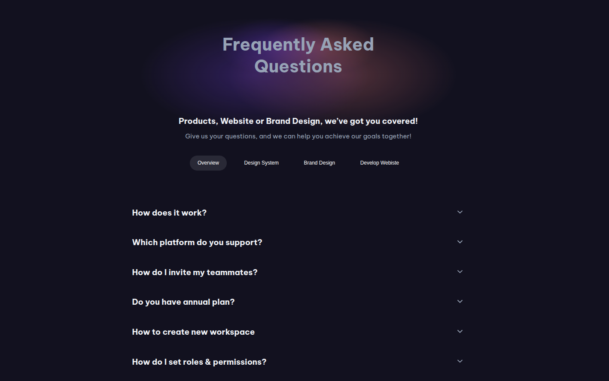

<h1 align="center">FAQ Page | devChallenges</h1>

  Solution for the <a href="https://devchallenges.io/challenge/faq-page" target="_blank" rel="noopener noreferrer">FAQ Page</a> challenge from <a href="https://devchallenges.io" target="_blank" rel="noopener noreferrer">devChallenges.io</a>.

  <h3>
    <a href="https://victorricci23.github.io/faq_page/">Demo</a>
     | 
    <a href="https://victorricci23.github.io/faq_page/">Solution</a>
     | 
    <a href="https://devchallenges.io/challenge/faq-page">Challenge</a>
  </h3>

<!-- TABLE OF CONTENTS -->

## Table of Contents

- [Overview](#overview)
  - [What I learned](#what-i-learned)
  - [Useful resources](#useful-resources)
- [Built with](#built-with)
- [Features](#features)
- [Acknowledgements](#acknowledgements)
- [Author](#author)

<!-- OVERVIEW -->

## Overview

This project is an FAQ page created as a solution to the devChallenges FAQ Page challenge. It organizes frequently asked questions into four categories: Overview, Design System, Brand Design, and Develop Website.

Users can select a category through the tabs at the top of the FAQ section. Each category displays its own list of questions, and each question can be expanded to show its answer through an accordion interaction.

The layout is styled with CSS and adapts to larger screens through a media query. JavaScript handles tab selection, accordion behavior, and the visual state of the interactive elements.

### What I learned

While building this project, I practiced the following concepts:

- **DOM manipulation:** selecting elements with `querySelectorAll()`, `querySelector()`, and `getElementById()`.
- **Event handling:** registering click events with `addEventListener()` and using event bubbling to handle clicks on the accordion header.
- **CSS classes with JavaScript:** using `classList.add()`, `classList.remove()`, and `classList.toggle()` to update the appearance of tabs and accordion items.
- **HTML data attributes:** using `data-tab` to associate each tab with the content section it controls.
- **Element visibility:** using the `hidden` property to show and hide tab panels and accordion answers.
- **Accessibility attributes:** using `aria-selected` to communicate the selected tab and `aria-expanded` to communicate the expanded or collapsed state of an accordion item.
- **Responsive design:** building the base layout for smaller screens and adjusting spacing and typography with a media query at `1024px`.
- **Flexbox:** arranging the page sections, tabs, and accordion content with flexible layouts.

One of the main lessons was understanding that an interactive component has both a visual state and a semantic state. For example, the `active` class changes the appearance of a selected tab, while `aria-selected` communicates that selection to assistive technologies.

### Useful resources

- [MDN – `querySelectorAll()`](https://developer.mozilla.org/en-US/docs/Web/API/Document/querySelectorAll) - Helped with selecting multiple elements from the document.
- [MDN – `addEventListener()`](https://developer.mozilla.org/en-US/docs/Web/API/EventTarget/addEventListener) - Reference for registering click event listeners.
- [MDN – `classList`](https://developer.mozilla.org/en-US/docs/Web/API/Element/classList) - Useful for adding, removing, and toggling CSS classes through JavaScript.
- [MDN – `dataset`](https://developer.mozilla.org/en-US/docs/Web/API/HTMLElement/dataset) - Explains how to access custom `data-*` attributes, such as `data-tab`.
- [MDN – `hidden`](https://developer.mozilla.org/en-US/docs/Web/HTML/Global_attributes/hidden) - Explains how the `hidden` attribute controls whether an element is rendered.
- [MDN – ARIA: `aria-selected`](https://developer.mozilla.org/en-US/docs/Web/Accessibility/ARIA/Attributes/aria-selected) - Explains how to communicate the selected state of an element.
- [MDN – ARIA: `aria-expanded`](https://developer.mozilla.org/en-US/docs/Web/Accessibility/ARIA/Attributes/aria-expanded) - Explains how to communicate whether a control expands or collapses content.
- [MDN – CSS media queries](https://developer.mozilla.org/en-US/docs/Web/CSS/CSS_media_queries/Using_media_queries) - Reference for adapting the layout to different screen sizes.

### Built with

- Semantic HTML5
- CSS3
- JavaScript (Vanilla JavaScript)
- Flexbox
- CSS media queries
- Be Vietnam Pro font

## Features

- Four navigable FAQ categories: Overview, Design System, Brand Design, and Develop Website.
- Tab interaction that displays the content associated with the selected category.
- Accordion interaction that expands and collapses answers when a question header is clicked.
- Visual feedback for active tabs and expanded accordion items.
- `aria-selected` and `aria-expanded` attributes to expose interaction states to assistive technologies.
- Responsive layout with adjustments for screens wider than `1024px`.

This project was created as a submission to the [devChallenges](https://devchallenges.io/challenges-dashboard) challenge platform.

## Acknowledgements

- [devChallenges.io](https://devchallenges.io/) for providing the FAQ Page challenge.
- [MDN Web Docs](https://developer.mozilla.org/) for documentation and references about HTML, CSS, JavaScript, and accessibility.

## Author

- Coded by **Victor C. Ricci**
- GitHub [@victorricci23](https://github.com/victorricci23)
